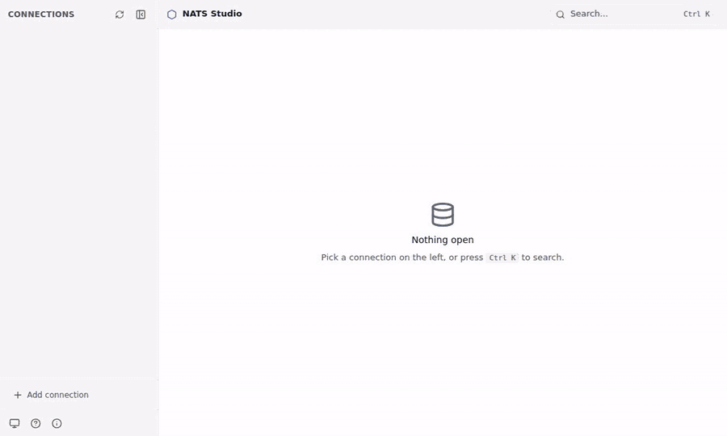

# NATS JetStream Studio

A free GUI and desktop client for NATS and JetStream. Connect to your NATS servers and browse
streams, consumers, subjects and messages from one place. Runs as a desktop app (Windows, macOS,
Linux) and, with the same UI, as a web app.



## What you can do

- **Connect** to several servers at once, with a colour per environment, read-only mode and
  automatic reconnect. Contexts from the `nats` CLI are found automatically.
- **Browse messages** in any stream without creating a consumer or acknowledging anything. Filter
  by subject, header, payload text, regex or JSONPath, and view payloads as JSON, text, hex, base64
  or Protobuf.
- **Manage streams and consumers**: create, edit, purge, delete, pause, and see lag and unhealthy
  consumers at a glance.
- **Tail and publish** on any subject, including request/reply.
- **Work with KV and Object Store**: browse, edit, watch, upload, download.
- **Monitor** streams and consumers with charts and alerts.
- **Stay safe**: every change is written to an audit log, and read-only mode blocks writes.

## Install

Download the installer for your system from the
[latest release](https://github.com/hardik-id/nats-jetstream-studio/releases/latest): Windows
(`.exe`), macOS (`.dmg`) or Linux (`.AppImage`, `.deb`).

The installers are **not code-signed yet**, so Windows SmartScreen and macOS Gatekeeper warn the
first time you open the app. See [docs/install.md](docs/install.md) for the steps to open it.

## Try it with demo data

If you have a checkout and no NATS server at hand, run each command in its own terminal (the
first two keep running):

```bash
npm install
npm run nats             # a local nats-server on 4222
npm run traffic          # demo streams, consumers, KV, objects and live traffic
npm run dev              # the desktop app
```

Add a connection to `nats://127.0.0.1:4222` with user `app` and password `app`.

## Web mode

Run the same UI from a browser, with the server holding the connections and credentials. See
[docs/web-mode.md](docs/web-mode.md).

## Documentation and contributing

- [docs/](docs/README.md): install, web mode, architecture, status
- [CONTRIBUTING.md](CONTRIBUTING.md): running from source, tests, code rules, releases

## License

[Apache-2.0](LICENSE)
